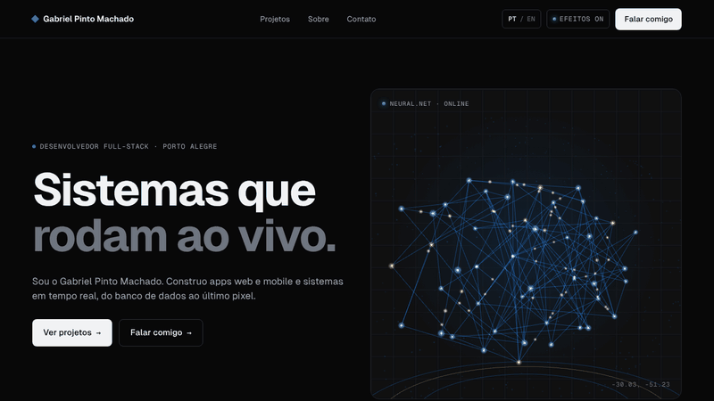
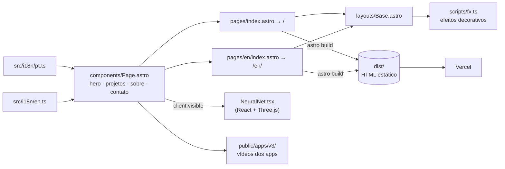

<div align="center">

# Portfólio · Gabriel Pinto Machado

**Site pessoal em Astro, React e Three.js, em português e inglês, com as gravações reais de cada projeto.**

[](https://github.com/GabrielPMachado/Portfolio/actions/workflows/ci.yml)


[**Ver o site**](https://portfolio-financy1.vercel.app) · [Arquitetura](#arquitetura) · [Como rodar](#como-rodar) · [English](#english)

</div>

<p align="center">
  
  <br />
  <sub>Topo do site, com a rede neural 3D e os cursores que montam a página. Veja ao vivo em <a href="https://portfolio-financy1.vercel.app">portfolio-financy1.vercel.app</a>.</sub>
</p>

## Sumário

- [Sobre](#sobre)
- [Recursos](#recursos)
- [Arquitetura](#arquitetura)
- [Stack](#stack)
- [Estrutura de pastas](#estrutura-de-pastas)
- [Como rodar](#como-rodar)
- [Qualidade e CI](#qualidade-e-ci)
- [Deploy](#deploy)
- [Decisões técnicas](#decisões-técnicas)
- [Licença](#licença)
- [English](#english)

## Sobre

Site pessoal com apresentação, projetos, sobre e contato, em português (`/`) e inglês (`/en/`). Cada projeto aparece com uma gravação real do app numa moldura de iPhone: [Financy](https://github.com/GabrielPMachado/Financy), O Vértice, [HypeApp](https://github.com/GabrielPMachado/HypeApp), [Bar do Dindo](https://github.com/GabrielPMachado/BarDoDindo) e [Órbita](https://github.com/GabrielPMachado/Orbita).

## Recursos

- **Rede neural 3D** no topo (Three.js): camadas de nós, ligações com brilho e pulsos de dados entre as camadas
- **Cursores que montam a página:** um bando de cursores "constrói" cada bloco quando ele entra na tela, depois some
- Títulos com texto embaralhado, caixas de seleção ao passar o mouse e relógio local
- **Gravações reais** de cada app (WebM e MP4, 60 fps, com pôster em JPG)
- Botão **Efeitos** que desliga toda a animação; a escolha fica salva no navegador
- Respeita `prefers-reduced-motion`: nada se mexe e o conteúdo aparece direto
- Bilíngue com as rotas de i18n do Astro

## Arquitetura

O site é gerado de forma estática pelo Astro. Quase tudo é HTML e CSS; só a rede neural é uma "ilha" React, carregada quando aparece na tela.



## Stack

| Camada | Tecnologias |
| --- | --- |
| Framework | Astro 5 (geração estática, i18n) |
| Interatividade | React 18 (ilha), Three.js, TypeScript |
| Estilo | CSS próprio (`global.css`, `page.css`), fontes Geist Sans e Geist Mono |
| Hospedagem | Vercel |

## Estrutura de pastas

```
.
├── .github/workflows/ci.yml   # build e checagem de tipos em todo push e PR
├── docs/demo.gif              # animação do README
├── public/apps/v3/            # gravações dos apps (webm, mp4 e pôster jpg)
├── src/
│   ├── components/
│   │   ├── Page.astro         # as seções (hero, projetos, sobre, contato)
│   │   └── NeuralNet.tsx      # a rede neural 3D do topo
│   ├── i18n/
│   │   ├── pt.ts              # todos os textos em português
│   │   └── en.ts              # todos os textos em inglês
│   ├── layouts/Base.astro     # <head>, metadados e scripts
│   ├── pages/
│   │   ├── index.astro        # /
│   │   └── en/index.astro     # /en/
│   ├── scripts/fx.ts          # cursores, texto embaralhado, botão de efeitos, relógio
│   └── styles/                # global.css e page.css
└── astro.config.mjs
```

Para mudar um texto, edite `src/i18n/pt.ts` e `src/i18n/en.ts`.

## Como rodar

### Pré-requisitos

- Node.js 20+

### Instalação

```bash
git clone https://github.com/GabrielPMachado/Portfolio.git
cd Portfolio
npm install
npm run dev      # http://localhost:4321
```

### Scripts

| Comando | O que faz |
| --- | --- |
| `npm run dev` | Servidor de desenvolvimento |
| `npm run build` | Gera o site estático em `dist/` |
| `npm run preview` | Serve o build localmente |

## Qualidade e CI

O workflow [`ci.yml`](.github/workflows/ci.yml) roda em todo push na `main` e em todo pull request: `npm ci`, build do Astro e checagem de tipos (`tsc --noEmit`).

## Deploy

Publicado na **Vercel** a cada push na `main`: framework Astro, sem variáveis de ambiente.

## Decisões técnicas

- **Astro com ilhas.** O conteúdo sai como HTML estático e só a rede neural carrega JavaScript de React, com `client:visible`, quando entra na tela. A página abre rápido mesmo com o 3D.
- **Efeitos opcionais.** Tudo em `fx.ts` é decorativo: a página está completa sem ele, o botão Efeitos desliga tudo e `prefers-reduced-motion` é respeitado. A rede neural pausa fora da tela.
- **Textos fora do layout.** Português e inglês ficam em dois arquivos de dicionário, e uma única `Page.astro` gera as duas versões.
- **Gravações em vez de demos.** Cada projeto mostra o app de verdade em vídeo (WebM com MP4 de reserva e pôster), em vez de uma ilustração.

## Licença

Projeto pessoal de [Gabriel Pinto Machado](https://github.com/GabrielPMachado). Todos os direitos reservados.

---

## English

<details open>
<summary><b>Portfolio: Gabriel Pinto Machado's personal site</b></summary>

### About

Personal website built with Astro, React and Three.js, in Portuguese (`/`) and English (`/en/`), live at **https://portfolio-financy1.vercel.app**. Each project is shown with a real recording of the app in an iPhone frame.

### Highlights

- 3D neural network hero (Three.js) that pauses off screen
- A flock of cursors that "assembles" each block as it scrolls into view
- Effects toggle saved in the browser, and full `prefers-reduced-motion` support
- Static output with a single React island loaded on visibility

### Getting started

```bash
git clone https://github.com/GabrielPMachado/Portfolio.git
cd Portfolio
npm install
npm run dev      # http://localhost:4321
```

| Script | Description |
| --- | --- |
| `npm run dev` | Dev server |
| `npm run build` | Static build into `dist/` |
| `npm run preview` | Serve the build locally |

All copy lives in `src/i18n/pt.ts` and `src/i18n/en.ts`.

### CI and deploy

`ci.yml` builds the site and type-checks on every push and pull request. Deployed on Vercel from `main`.

### License

Personal project by [Gabriel Pinto Machado](https://github.com/GabrielPMachado). All rights reserved.

</details>
